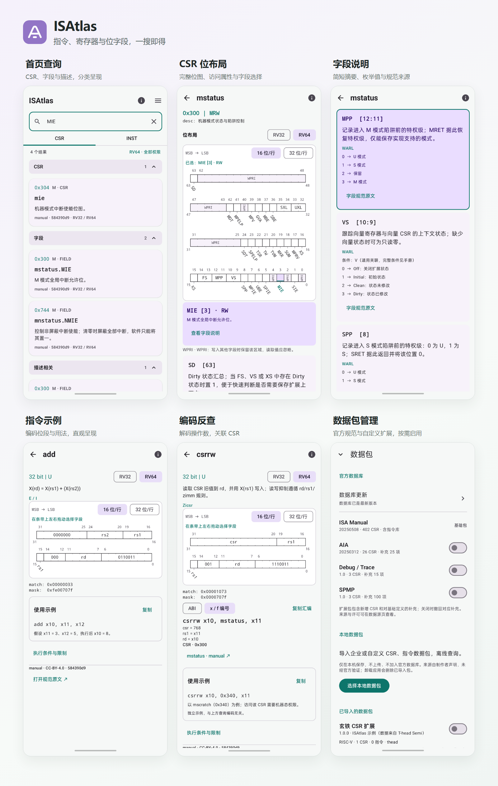
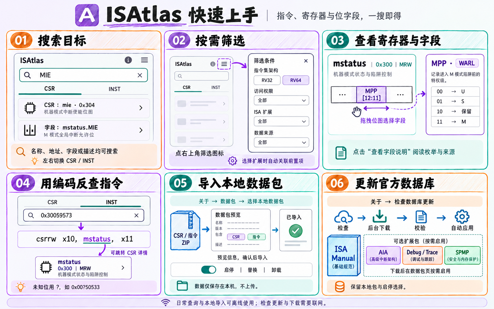

# ISAtlas

**指令、寄存器与位字段，一搜即得**

Android 上的离线架构速查工具，支持 RISC-V 指令、CSR 与字段查询。

[下载安装](#下载安装) · [功能预览](#功能预览) · [快速上手](#快速上手) · [开发看板](https://github.com/users/noionion/projects/5) · [使用文档](#文档) · [问题反馈](https://github.com/noionion/ISAtlas/issues)

---

输入指令名、机器码、寄存器名称、地址或字段名，快速查看编码、位布局、功能说明和取值含义。适合阅读底层代码、调试系统，以及学习 RISC-V 架构时随手查阅。

## 功能预览

## 下载安装

- **[稳定版 0.5.0](https://github.com/noionion/ISAtlas/releases/latest)**：支持指令查询、完整／部分编码反查与伪指令参考。
- **[预览版 0.6.0-beta.1](https://github.com/noionion/ISAtlas/releases/tag/v0.6.0-beta.1)**：新增指令使用示例、本地数据包导入与数据库独立更新。
- **[全部版本](https://github.com/noionion/ISAtlas/releases)**：查看历史版本、预览版与更新日志。

在对应版本的 Assets 中下载 APK 安装，随包提供更新日志与 SHA-256 校验文件。现有用户可覆盖升级并保留应用数据；在「关于 → 更新通道」选择稳定版或预览版。

软件更新在后台下载，支持取消、暂停和继续，完成后可安装；暂停后继续会重新下载安装包。

## 特性

| | 功能 | 说明 |
| --- | --- | --- |
| 🔎 | 快速搜索 | 搜索名称、地址、字段和描述，支持 `mstatus`、`0x300`、`mstatus.MIE` 等查询 |
| ⚙️ | 指令速查 | 按名称查看指令编码，输入 binary / hex 反查指令与操作数，CSR / INST 左右分页切换 |
| 🔢 | 部分编码查询 | 用 `?` 标记未知位，查找可能的指令；已知操作数与未确定项分别显示 |
| 🔗 | 别名与伪指令 | 查看别名对应的基础指令，查阅伪指令展开、适用条件与规范来源 |
| 💡 | 指令示例 | 在指令详情查看使用示例，结合操作数和简短语义理解用法 |
| 🧩 | 位域一目了然 | 图形化展示寄存器布局，点击或拖拽选择字段，查看对应功能 |
| 📖 | 取值有据可查 | 中文功能摘要、枚举值与访问规则，支持跳转到规范原文 |
| 🎛️ | 按需筛选 | 按 RV32 / RV64、访问权限、扩展和数据来源筛选 |
| 📱 | 横竖屏适配 | 横屏支持多列结果与更宽位图，返回列表保留浏览位置 |
| 📦 | 离线使用 | 数据随应用提供，日常查询无需联网 |
| 🗂️ | 本地数据包 | 导入自定义 CSR / 指令 ZIP，支持预览、启停、替换与卸载，数据仅保存在本机 |
| 🔄 | 数据库独立更新 | 无需更新 APK 即可更新官方数据，后台下载、校验通过后自动应用 |

## 快速上手

从搜索、筛选到扩展数据，六步了解常用操作。

## 数据包与数据库更新

应用默认内置 **RISC-V ISA Manual**，安装后即可离线查询 CSR、字段与指令。在「关于 → 检查数据库更新」下载独立发布的官方数据库，可获得 AIA、Debug / Trace、SPMP 等规范数据，并在数据包页按需启用。

数据库与软件分别维护版本，官方与镜像并行检查，支持更新日志、跳过版本和取消下载。下载期间可继续查询，校验通过后自动应用；更新保留本地包及官方包启停选择，新增加的可选包默认关闭。

企业或个人自定义数据可在「关于 → 数据包」选择本地 ZIP 导入。导入前展示内容、来源与冲突信息，按来源共存；本地包不上传，也不会被官方数据库更新覆盖。制作方法见[本地数据包文档](docs/local-packages.md)，官方数据与来源审核维护于 [ISAtlas-data](https://github.com/noionion/ISAtlas-data)。

## 搜索示例

| 输入 | 查看内容 |
| --- | --- |
| `mstatus` / `0x300` | CSR 说明与位布局 |
| `mstatus.MIE` | 字段功能、访问属性与取值 |
| `add` / `ret` | 指令、别名的编码与使用示例 |
| `call` / `vmsge.vx` | 伪指令的参考展开与适用条件 |
| `0x00b50533` | 反查 `add` 并解码寄存器操作数 |
| `0x00?50533` | 根据已知位查找候选指令 |

支持 binary / hex 输入、ABI / 数字寄存器名切换，以及从指令跳转到相关 CSR。输入格式、部分编码和查询提示见[查询使用指南](docs/usage.md)。

## 运行要求

| 项目 | 要求 |
| --- | --- |
| 系统版本 | Android 8.0 及以上（API 26） |
| 支持架构 | RISC-V RV32 / RV64 |
| 网络连接 | 日常查询与本地包导入无需联网；软件／数据库更新及打开外部规范原文时需要联网 |

## 开发计划

后续功能与开发进度可在 [ISAtlas Roadmap](https://github.com/users/noionion/projects/5) 公开查看。功能建议与问题反馈请通过 [Issues](https://github.com/noionion/ISAtlas/issues) 提交。

## 文档

| 文档 | 说明 |
| --- | --- |
| [查询使用指南](docs/usage.md) | 搜索、编码输入、部分编码与查询提示 |
| [构建指南](docs/build.md) | 从源码构建、安装与开发验证 |
| [看板维护规则](docs/project-maintenance.md) | 功能规划、任务清单、状态流转与 Issue 协作 |
| [独立数据仓库](https://github.com/noionion/ISAtlas-data) | CSR、指令与字段数据、来源和审核 |
| [数据维护](docs/data-maintenance.md) | 本地候选包联调与内置基线同步 |
| [数据库更新](docs/database-updates.md) | 独立版本、后台下载、校验与自动应用 |
| [本地数据包](docs/local-packages.md) | 导入与管理自定义 CSR / 指令包 |
| [覆盖范围](docs/field-review.md) | CSR 与字段的收录范围及复核说明 |
| [数据格式](docs/data-format.md) | CSR JSON 结构与字段约定 |
| [指令数据](docs/instruction-data.md) | 指令编码、双语摘要、提取与审核方式 |
| [伪指令与别名清单](docs/pseudoinstruction-coverage.md) | 已收录名称、展开参考与来源边界 |

## 反馈与致谢

欢迎通过 [Issues](https://github.com/noionion/ISAtlas/issues) 反馈问题或提出建议。数据问题请附上指令名、机器码或 CSR / 字段名称，以及规范出处，界面问题请附上复现步骤。

感谢 [RISC-V ISA Manual](https://github.com/riscv/riscv-isa-manual)、[AIA](https://github.com/riscv/riscv-aia)、[Debug Specification](https://github.com/riscv/riscv-debug-spec) 与 [SPMP](https://github.com/riscv/riscv-spmp) 提供规范资料，以及 [T-head Extension Specification](https://github.com/T-head-Semi/thead-extension-spec) 提供公开扩展示例。第三方数据的署名与许可证见[第三方声明](app/src/main/assets/THIRD_PARTY_NOTICES.txt)及应用的数据源与许可页。
