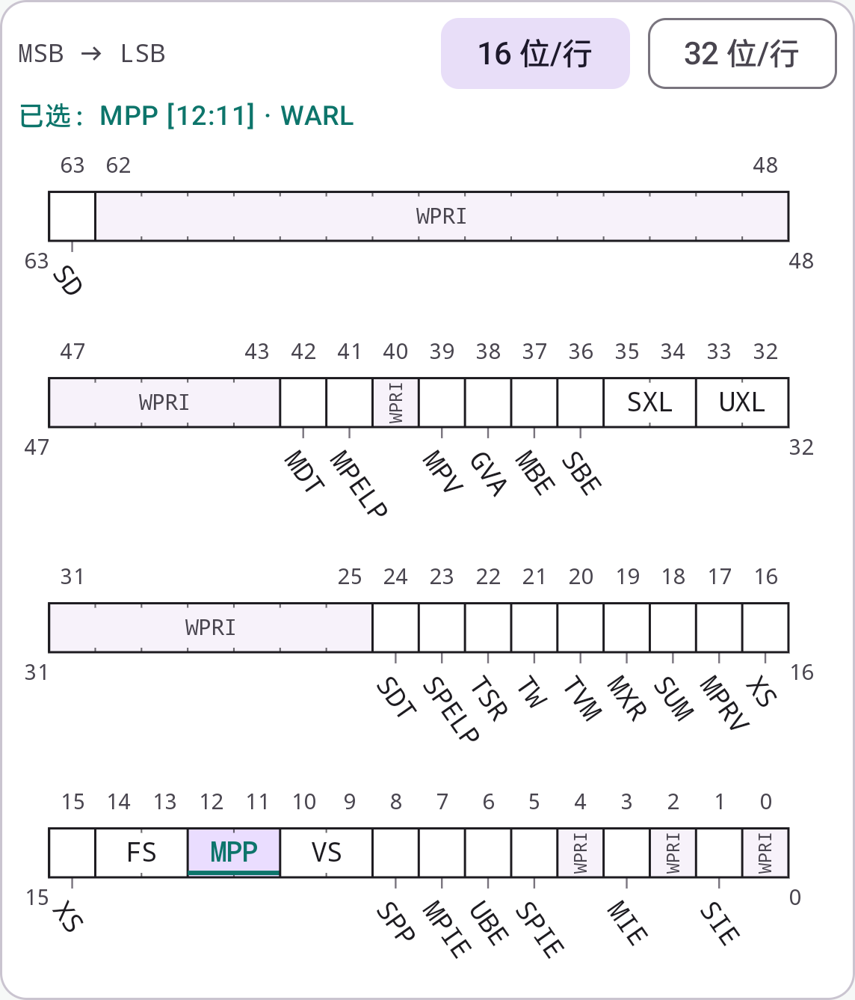
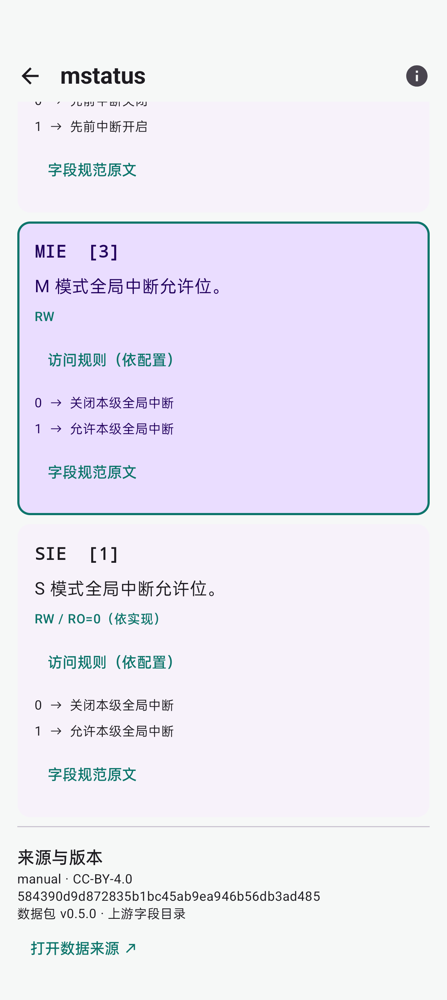
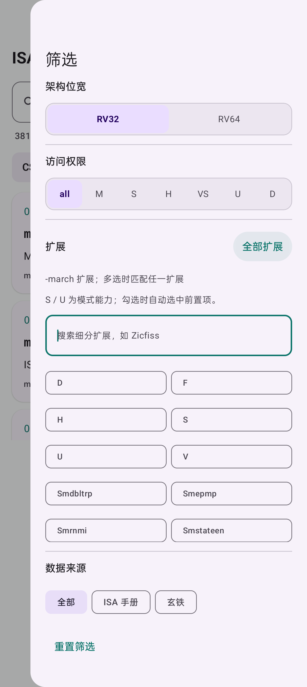

# ISAtlas

**指令、寄存器与位字段，一搜即得**

Android 上的离线架构速查工具，支持 RISC-V 指令、CSR 与字段查询。

[下载安装](#下载安装) · [功能预览](#功能预览) · [开发看板](https://github.com/users/noionion/projects/5) · [使用文档](#文档) · [问题反馈](https://github.com/noionion/ISAtlas/issues)

---

输入指令名、机器码、寄存器名称、地址或字段名，快速查看编码、位布局、功能说明和取值含义。适合阅读底层代码、调试系统，以及学习 RISC-V 架构时随手查阅。

## 下载安装

- **[稳定版](https://github.com/noionion/ISAtlas/releases/latest)**：适合日常使用。
- **[预览版 0.5.0-beta.1](https://github.com/noionion/ISAtlas/releases/tag/v0.5.0-beta.1)**：体验新增的指令查询与编码反查。

在对应版本的 Assets 中下载 APK 安装；更新日志及 SHA-256 校验文件随版本提供。预览版沿用现有应用签名，可覆盖安装并保留应用数据。

## 特性

| | 功能 | 说明 |
| --- | --- | --- |
| 🔎 | 快速搜索 | 搜索名称、地址、字段和描述，支持 `mstatus`、`0x300`、`mstatus.MIE` 等查询 |
| ⚙️ | 指令速查 | 按名称查看指令编码，输入 binary / hex 反查指令与操作数，CSR / INST 左右分页切换 |
| 🧩 | 位域一目了然 | 图形化展示寄存器布局，点击或拖拽选择字段，查看对应功能 |
| 📖 | 取值有据可查 | 中文功能摘要、枚举值与访问规则，支持跳转到规范原文 |
| 🎛️ | 按需筛选 | 按 RV32 / RV64、访问权限、扩展和数据来源筛选 |
| 📱 | 横竖屏适配 | 横屏支持多列结果与更宽位图，返回列表保留浏览位置 |
| 📦 | 离线使用 | 数据随应用提供，日常查询无需联网 |

## 搜索示例

搜索框下方切换 **CSR / INST**，也可以左右滑动。两页共用位宽、权限、扩展与来源筛选，各自保留浏览位置。

| 页面 | 输入 | 查看内容 |
| --- | --- | --- |
| CSR | `mstatus` / `0x300` | 寄存器说明与位布局 |
| CSR | `mstatus.MIE` | 对应字段的功能与取值 |
| INST | `add` / `ret` | 指令或已收录别名的编码规则、扩展与简短语义 |
| INST | `0x00b50533` | 匹配 `add`，解码 `rd=x10`、`rs1=x10`、`rs2=x11` |
| INST | `0b00000000101101010000010100110011` | 同一指令的二进制反查，支持空格或下划线分组 |

指令详情可查看编码变体、16 / 32 位布局、操作数、执行条件与规范来源。编码匹配表示符合已收录的编码规则；扩展与运行状态要求可在详情中查看。

## 功能预览

<table>
  <tr>
    <th>寄存器位布局</th>
    <th>字段说明与取值</th>
    <th>筛选面板</th>
  </tr>
  <tr>
    <td align="center" valign="top"></td>
    <td align="center" valign="top"></td>
    <td align="center" valign="top"></td>
  </tr>
</table>

## 运行要求

| 项目 | 要求 |
| --- | --- |
| 系统版本 | Android 8.0 及以上（API 26） |
| 支持架构 | RISC-V RV32 / RV64 |
| 网络连接 | 离线查询无需联网；检查更新、下载安装包或打开外部规范原文时需要联网 |

## 开发计划

后续功能与开发进度可在 [ISAtlas Roadmap](https://github.com/users/noionion/projects/5) 公开查看。功能建议与问题反馈请通过 [Issues](https://github.com/noionion/ISAtlas/issues) 提交。

## 文档

| 文档 | 说明 |
| --- | --- |
| [构建指南](docs/build.md) | 从源码构建、安装与开发验证 |
| [看板维护规则](docs/project-maintenance.md) | 功能规划、任务清单、状态流转与 Issue 协作 |
| [数据来源](docs/data-import.md) | 规范版本、数据维护与转换方式 |
| [覆盖范围](docs/field-review.md) | CSR 与字段的收录范围及复核说明 |
| [数据格式](docs/data-format.md) | CSR JSON 结构与字段约定 |
| [指令数据](docs/instruction-data.md) | 指令编码、双语摘要、提取与审核方式 |

## 反馈与致谢

欢迎通过 [Issues](https://github.com/noionion/ISAtlas/issues) 反馈问题或提出建议。数据问题请附上指令名、机器码或 CSR / 字段名称，以及规范出处，界面问题请附上复现步骤。

感谢 [RISC-V ISA Manual](https://github.com/riscv/riscv-isa-manual) 与 [T-head Extension Specification](https://github.com/T-head-Semi/thead-extension-spec) 提供规范资料。第三方数据的署名与许可证见 [第三方声明](app/src/main/assets/THIRD_PARTY_NOTICES.txt)。
